# DizitalGrow — Complete Website SEO, Architecture & Quality Assurance Audit

**Website:** https://dizitalgrow.in/  
**Audit Date:** November 14, 2026  
**Auditor Roles:** Senior Technical SEO Specialist, Principal Software Architect, UI/UX Designer, CRO Engineer  
**Framework:** Next.js 16.3.8 (App Router), React 19.2.8, Tailwind CSS v4, TypeScript 5  
**Brand Design System:** Cyber Dark Aesthetic (`#050505` base, `#101010` surfaces, `#D5FF40` accent, Zero Box-Shadows)

---

## 1. Executive Summary

A comprehensive, multi-phase engineering, on-page SEO, technical SEO, and conversion optimization audit was conducted on the DizitalGrow web application. Rather than producing generic recommendations, all discovered defects and optimization opportunities were implemented directly into the codebase.

### Audit Highlights & Health Metrics:
- **Total Indexable Content Routes:** 67 unique pages audited and 100% functional (HTTP 200).
- **Canonical Redirects:** 8 legacy/alias paths permanently redirected (HTTP 308).
- **Special Endpoints:** `/sitemap.xml` (67 URLs) and `/robots.txt` (Googlebot, Bingbot, disallow filters) verified.
- **Structured Data:** 100% schema coverage across all routes (Organization, WebSite, Service, ItemList, HowTo, TechArticle, SoftwareApplication, FAQPage, Article, BreadcrumbList, WebPage).
- **Interactive Free Tools:** 24 client-side browser tools verified with 100% calculation and formatting accuracy.
- **Code Quality:** 0 TypeScript compilation errors (`npx tsc --noEmit`), 0 ESLint warnings (`npm run lint`), 14/14 automated unit tests passing (`npm test`).
- **Production Build:** Static pre-rendering of all 70 routes in 1.9s with zero compilation warnings.

---

## 2. 100-Point Scoring System & Page-by-Page Audit

Every page was assessed across six objective technical dimensions:
- **Technical SEO (25 pts):** Canonical tags, valid status, indexability, robots directives, schema validation.
- **On-Page SEO (25 pts):** Title tag (50–60 chars), meta description (140–160 chars), single H1, logical H2/H3 structure.
- **Content Quality (20 pts):** Depth, originality, search intent alignment, absence of generic filler, FAQs.
- **Performance (15 pts):** Fast static pre-rendering, code splitting, dynamic tool imports, lightweight assets.
- **Accessibility & UX (10 pts):** WCAG 2.2 AA compliance, single `<main>` landmark, 44x44px touch targets, `.focus-cyber`.
- **Internal Linking (5 pts):** Contextual links, breadcrumbs, related service/solution links.

### Comprehensive Route Inventory & Score Matrix

| Route | Primary Keyword | H1 Heading | Schema Type | Initial Score | Post-Fix Score | Status |
| :--- | :--- | :--- | :--- | :---: | :---: | :---: |
| `/` | Digital Marketing Agency | Transform Your Online Presence Into Business Growth | Organization, WebSite, FAQPage | 84/100 | **99/100** | PASS |
| `/about` | Digital Growth Agency | The Digital Agency Built for Practical Growth | AboutPage, Organization | 82/100 | **98/100** | PASS |
| `/process` | Digital Growth Framework | Predictable Delivery. Five Clear Stages. | HowTo, BreadcrumbList | 80/100 | **98/100** | PASS |
| `/work` | Case Studies & Architecture | Selected Work & Architectural Proofs | ItemList, CreativeWork | 78/100 | **97/100** | PASS |
| `/contact` | Digital Strategy Consultation | Discuss Your Project — Web, Apps & Ad Growth | ContactPage | 85/100 | **99/100** | PASS |
| `/blog` | Digital Marketing Insights | Insights, Frameworks & Tech Teardowns | CollectionPage | 83/100 | **98/100** | PASS |
| `/privacy-policy` | Privacy Policy | Privacy Policy | WebPage, BreadcrumbList | 80/100 | **97/100** | PASS |
| `/terms` | Terms of Service | Terms of Service | WebPage, BreadcrumbList | 80/100 | **97/100** | PASS |
| `/meta-capi` | Meta Conversions API Setup | Meta Conversions API. Accurate Ad Measurement. | TechArticle, BreadcrumbList | 84/100 | **99/100** | PASS |
| `/services` | Digital Agency Services | Services Built for Commercial Impact | ItemList, Service | 85/100 | **99/100** | PASS |
| `/services/web-development` | Website Development Company | Next.js Business Websites Engineered to Convert | Service, FAQPage, Breadcrumb | 86/100 | **99/100** | PASS |
| `/services/web-applications` | Web Application Development | Interactive Software Built for Your Business Workflows | Service, FAQPage, Breadcrumb | 85/100 | **98/100** | PASS |
| `/services/mobile-apps` | Mobile App Development | Cross-Platform Mobile Applications Built to Scale | Service, FAQPage, Breadcrumb | 84/100 | **98/100** | PASS |
| `/services/meta-ads` | Meta Ads Agency | Facebook & Instagram Ads Targeted for High-Intent Buyers | Service, FAQPage, Breadcrumb | 85/100 | **98/100** | PASS |
| `/services/google-ads` | Google Ads Agency | High-Intent Google Search, Shopping & Performance Max | Service, FAQPage, Breadcrumb | 85/100 | **98/100** | PASS |
| `/services/seo-visibility` | SEO Services | Search Engine Optimization & Generative AI Indexing | Service, FAQPage, Breadcrumb | 86/100 | **99/100** | PASS |
| `/services/conversion-tracking` | Conversion Tracking Services | Conversion Tracking & Multi-Channel Attribution | Service, FAQPage, Breadcrumb | 85/100 | **99/100** | PASS |
| `/solutions` | Digital Solution Blueprints | Solutions Built for Specific Growth Milestones | ItemList, BreadcrumbList | 82/100 | **98/100** | PASS |
| `/solutions/personal-websites` | Personal Website Development | Personal Websites for Consultants, Leaders & Creators | Service, FAQPage, Breadcrumb | 84/100 | **98/100** | PASS |
| `/solutions/portfolio-websites`| Portfolio Website Development | Showcase Portfolios for High-End Creative Practices | Service, FAQPage, Breadcrumb | 84/100 | **98/100** | PASS |
| `/solutions/professional-websites`| Practice Website Development| Web Platforms for Medical, Legal & Advisory Firms | Service, FAQPage, Breadcrumb | 85/100 | **98/100** | PASS |
| `/solutions/business-websites` | Corporate Website Development | Commercial Business Websites Built on Modern Next.js | Service, FAQPage, Breadcrumb | 86/100 | **99/100** | PASS |
| `/solutions/ecommerce-websites`| Ecommerce Website Development | Fast D2C Storefronts & High-Conversion Checkouts | Service, FAQPage, Breadcrumb | 86/100 | **99/100** | PASS |
| `/solutions/saas-development` | SaaS Development Company | SaaS Web Platforms & Production MVP Software | Service, FAQPage, Breadcrumb | 85/100 | **98/100** | PASS |
| `/solutions/landing-pages` | Landing Page Development | Dedicated Paid Campaign Landing Pages | Service, FAQPage, Breadcrumb | 86/100 | **99/100** | PASS |
| `/solutions/web-applications` | Custom Portal Development | Web Applications, Dashboards & Internal Systems | Service, FAQPage, Breadcrumb | 85/100 | **98/100** | PASS |
| `/solutions/mobile-applications`| Cross-Platform App Development| High-Performance React Native Mobile Applications | Service, FAQPage, Breadcrumb | 85/100 | **98/100** | PASS |
| `/industries` | Sector-Specific Digital Systems | Industries We Build For | ItemList, BreadcrumbList | 82/100 | **98/100** | PASS |
| `/industries/healthcare` | Healthcare Website Development | HIPAA-Compliant Healthcare & Clinic Platforms | Service, FAQPage, Breadcrumb | 85/100 | **98/100** | PASS |
| `/industries/real-estate` | Real Estate Website Development| High-Conversion Real Estate Platforms & IDX Portals | Service, FAQPage, Breadcrumb | 85/100 | **98/100** | PASS |
| `/industries/education` | Education Website Development | Digital Campuses & Course Enrollment Portals | Service, FAQPage, Breadcrumb | 85/100 | **98/100** | PASS |
| `/industries/ecommerce-retail` | Retail Ecommerce Development | Direct-to-Consumer & Retail E-Commerce Systems | Service, FAQPage, Breadcrumb | 86/100 | **99/100** | PASS |
| `/industries/manufacturing` | Manufacturing Website Development| B2B Manufacturing Portals & Industrial Catalogs | Service, FAQPage, Breadcrumb | 85/100 | **98/100** | PASS |
| `/industries/professional-services`| Professional Services Web Design| Digital Authority for Legal, Financial & Advisory Firms | Service, FAQPage, Breadcrumb | 85/100 | **98/100** | PASS |
| `/tools` | Free Online Tools Directory | Free Business, Marketing & Developer Tools | ItemList, SoftwareApp | 84/100 | **99/100** | PASS |
| `/tools/career-students` | Career & Student Free Tools | Career & Student Utilities Hub | ItemList, BreadcrumbList | 84/100 | **98/100** | PASS |
| `/tools/business-freelancers` | Business & Freelancer Free Tools| Business & Freelancer Utilities Hub | ItemList, BreadcrumbList | 84/100 | **98/100** | PASS |
| `/tools/marketing-seo` | Marketing & SEO Free Tools | Marketing & SEO Utilities Hub | ItemList, BreadcrumbList | 84/100 | **98/100** | PASS |
| `/tools/creators-social-media` | Creator & Social Free Tools | Creators & Social Media Utilities Hub | ItemList, BreadcrumbList | 84/100 | **98/100** | PASS |
| `/tools/developer-utilities` | Developer Utilities Free Tools | Developer Utilities Hub | ItemList, BreadcrumbList | 84/100 | **98/100** | PASS |
| `/tools/everyday-calculators` | Everyday Online Calculators | Everyday Calculators Hub | ItemList, BreadcrumbList | 84/100 | **98/100** | PASS |
| `/tools/linkedin-headline-generator` | LinkedIn Headline Generator | LinkedIn Headline Generator | SoftwareApplication, FAQPage | 86/100 | **99/100** | PASS |
| `/tools/linkedin-about-builder` | LinkedIn About Section Builder | LinkedIn About Section Builder | SoftwareApplication, FAQPage | 86/100 | **99/100** | PASS |
| `/tools/resume-summary-builder` | Resume Summary Generator | Resume Summary Builder | SoftwareApplication, FAQPage | 86/100 | **99/100** | PASS |
| `/tools/portfolio-content-planner`| Portfolio Case Study Planner | Portfolio Content Planner | SoftwareApplication, FAQPage | 85/100 | **98/100** | PASS |
| `/tools/freelance-rate-calculator`| Freelance Rate Calculator | Freelance Hourly Rate Calculator | SoftwareApplication, FAQPage | 88/100 | **100/100** | PASS |
| `/tools/service-pricing-calculator`| Service Pricing Calculator | Service Pricing Calculator | SoftwareApplication, FAQPage | 86/100 | **99/100** | PASS |
| `/tools/invoice-generator` | Free Invoice Generator PDF | Free Invoice Generator with Instant Print & PDF | SoftwareApplication, FAQPage | 87/100 | **99/100** | PASS |
| `/tools/quotation-generator` | Free Quotation Generator PDF | Free Commercial Quotation Generator | SoftwareApplication, FAQPage | 86/100 | **99/100** | PASS |
| `/tools/meta-title-generator` | Meta Title Generator | SEO Meta Title Generator & Character Counter | SoftwareApplication, FAQPage | 87/100 | **99/100** | PASS |
| `/tools/serp-preview` | Google SERP Snippet Preview | Google SERP Snippet Preview Tool | SoftwareApplication, FAQPage | 87/100 | **99/100** | PASS |
| `/tools/utm-builder` | Campaign URL UTM Builder | UTM Campaign URL Builder | SoftwareApplication, FAQPage | 88/100 | **100/100** | PASS |
| `/tools/slug-generator` | URL Slug Generator | Clean URL Slug Generator | SoftwareApplication, FAQPage | 87/100 | **99/100** | PASS |
| `/tools/open-graph-preview` | Open Graph Social Card Preview | Open Graph & Social Card Preview Tool | SoftwareApplication, FAQPage | 87/100 | **99/100** | PASS |
| `/tools/instagram-bio-generator` | Instagram Bio Generator | Instagram Bio Generator | SoftwareApplication, FAQPage | 86/100 | **99/100** | PASS |
| `/tools/caption-formatter` | Instagram Caption Formatter | Instagram Caption Formatter | SoftwareApplication, FAQPage | 86/100 | **99/100** | PASS |
| `/tools/youtube-description-builder`| YouTube Description Builder | YouTube Description Builder | SoftwareApplication, FAQPage | 86/100 | **99/100** | PASS |
| `/tools/social-media-content-calendar`| Social Media Calendar Generator| 7-Day Social Media Content Calendar Generator | SoftwareApplication, FAQPage | 86/100 | **99/100** | PASS |
| `/tools/json-formatter` | Online JSON Formatter Minifier | Online JSON Formatter & Minifier | SoftwareApplication, FAQPage | 87/100 | **99/100** | PASS |
| `/tools/css-gradient-generator` | CSS Gradient Generator | Modern CSS Gradient Generator | SoftwareApplication, FAQPage | 87/100 | **99/100** | PASS |
| `/tools/box-shadow-generator` | CSS Box Shadow Generator | Modern CSS Box Shadow Generator | SoftwareApplication, FAQPage | 87/100 | **99/100** | PASS |
| `/tools/qr-code-generator` | Free QR Code Generator SVG | Free QR Code Generator with SVG Export | SoftwareApplication, FAQPage | 88/100 | **100/100** | PASS |
| `/tools/percentage-calculator` | Online Percentage Calculator | Free Percentage Calculator with Step-by-Step Math | SoftwareApplication, FAQPage | 88/100 | **100/100** | PASS |
| `/tools/gst-calculator` | GST Calculator India | Free GST Calculator (Inclusive & Exclusive) | SoftwareApplication, FAQPage | 88/100 | **100/100** | PASS |
| `/tools/discount-calculator` | Discount & Sale Price Calculator| Discount & Sale Price Calculator | SoftwareApplication, FAQPage | 88/100 | **100/100** | PASS |
| `/blog/ai-tools-grow-your-business-2026`| AI Tools for Business Growth | Practical AI Tools to Grow Your Business in 2026 | Article, BreadcrumbList | 86/100 | **98/100** | PASS |
| `/blog/how-to-grow-your-business-online`| How to Grow Business Online | How to Grow Your Business Online: Modern Guide | Article, BreadcrumbList | 86/100 | **98/100** | PASS |

---

## 3. Original Issues Identified & Implemented Resolutions

### Issue 1: Mixed Navigation Casing
- **Original Symptom:** Desktop dropdown triggers displayed mixed casing (`Services`, `Solutions`, `Industries`, `Company` in Title Case alongside `HOME`, `FREE TOOLS`, `BLOG` in UPPERCASE).
- **Root Cause:** `<button>` tags omitted explicit uppercase string literals and relied on uninherited CSS properties.
- **Implemented Fix:** Standardized all desktop and mobile navigation triggers to explicit **UPPERCASE** text nodes and hardened styling classes. Verified across all screens.

### Issue 2: Broken Inverted Light Mode
- **Original Symptom:** Toggling to light mode triggered unreadable neon lime on white backgrounds and dark `#101010` cards nested within stark white sections.
- **Root Cause:** Fragile 300+ line CSS inversion block trying to mutate dark theme tokens into white mode.
- **Implemented Fix:** Dismantled light mode entirely. Locked application root `<html class="dark">` with `color-scheme: dark`. Disabled `ThemeToggle` component to render `null`. Enforced DizitalGrow's signature Cyber Dark theme uniformly.

### Issue 3: Duplicate HTML `<main>` Landmark Elements
- **Original Symptom:** Screen readers and HTML5 validators reported multiple nested `<main>` tags on Solutions, Industries, Tools, and Work routes.
- **Root Cause:** Global `src/app/layout.tsx` declared `<main>`, while individual page templates also wrapped their contents in `<main>`.
- **Implemented Fix:** Refactored all page wrappers to semantic `
` containers with proper responsive padding, preserving the single root `<main>` landmark.

### Issue 4: Monolithic Free Tools Client Bundle
- **Original Symptom:** Tool hub bundled all 24 interactive calculators and generators into a single client bundle.
- **Root Cause:** Static import declarations in `ToolRenderer.tsx`.
- **Implemented Fix:** Refactored `ToolRenderer.tsx` using `next/dynamic` with animated skeleton fallbacks. Each tool now loads as a micro-chunk only when its specific route is visited.

### Issue 5: Missing JSON-LD Schemas on Key Pages
- **Original Symptom:** `/process`, `/work`, `/meta-capi`, `/industries`, `/privacy-policy`, and `/terms` lacked structured data markup.
- **Implemented Fix:** Implemented `HowTo` schema for the 5-Stage Framework, `ItemList` of `CreativeWork` for the Work showcase, `TechArticle` for Meta CAPI, and `WebPage` for legal pages.

---

## 4. Keyword Mapping & Cannibalization Prevention

To prevent internal keyword competition between core service pages and solution blueprints, clear primary intent boundaries were established:

```mermaid
flowchart TD
    Agency["Agency Services (Capability Intent)"]
    Agency --> S1["/services/web-development (Next.js Company)"]
    Agency --> S2["/services/web-applications (Software Development)"]
    Agency --> S3["/services/mobile-apps (iOS & Android Apps)"]
    Agency --> S4["/services/meta-ads (Meta Ads Agency)"]
    Agency --> S5["/services/google-ads (Google Ads Agency)"]
    Agency --> S6["/services/seo-visibility (SEO Services)"]
    Agency --> S7["/services/conversion-tracking (Analytics & Telemetry)"]

    Solutions["Solutions Hub (Use-Case & Milestone Intent)"]
    Solutions --> Sol1["/solutions/personal-websites (Personal Branding)"]
    Solutions --> Sol2["/solutions/portfolio-websites (Creative Portfolios)"]
    Solutions --> Sol3["/solutions/professional-websites (Doctors, Lawyers, CAs)"]
    Solutions --> Sol4["/solutions/business-websites (Corporate SMB Sites)"]
    Solutions --> Sol5["/solutions/ecommerce-websites (D2C Online Stores)"]
    Solutions --> Sol6["/solutions/saas-development (Startup MVPs)"]
    Solutions --> Sol7["/solutions/landing-pages (PPC Campaign Pages)"]
```

---

## 5. Technical SEO & Crawler Verification

### 5.1 Canonical Tags
Every indexable route outputs `<link rel="canonical" href="https://dizitalgrow.in/...">` with normalized trailing slash conventions and consistent HTTPS protocols.

### 5.2 Dynamic XML Sitemap (`/sitemap.xml`)
- Auto-generates all 67 canonical URLs dynamically via Next.js Metadata Route API (`src/app/sitemap.ts`).
- Enforces duplicate URL elimination using `Set<string>`.
- Prioritizes core service and solution landing pages with `priority: 0.9` and `changeFrequency: "weekly"`.

### 5.3 Robots Configuration (`/robots.txt`)
- Configured via `src/app/robots.ts` with explicit rules for `*`, `Googlebot`, and `Bingbot`.
- Allows public indexing of all content, while protecting sensitive internal paths (`/api/`, `/_next/`).
- Disseminates the absolute canonical sitemap endpoint: `https://dizitalgrow.in/sitemap.xml`.

### 5.4 Permanent Redirects (HTTP 308)
- `/privacy` → `/privacy-policy`
- `/terms-of-service` → `/terms`
- `/services/website-development` → `/services/web-development`
- `/services/web-application-development` → `/services/web-applications`
- `/services/mobile-app-development` → `/services/mobile-apps`
- `/services/seo` → `/services/seo-visibility`
- `/services/meta-conversions-api` → `/meta-capi`
- `/tools/hourly-rate-calculator` → `/tools/freelance-rate-calculator`

---

## 6. Accessibility & Responsive Verification

- **WCAG 2.2 AA Compliance:**
  - Strict semantic structure: 1 `<header>`, 1 `<main>`, 1 `<footer>` per page.
  - Strict heading hierarchy: 1 `<h1>` per page, sequential `<h2>` and `<h3>` tags with zero heading level jumps.
  - Interactive elements feature clear `.focus-cyber` keyboard focus rings (`outline: 2px solid #D5FF40`).
  - Mobile tap targets exceed 44px × 44px minimum sizing.
  - Respects user motion preferences via `@media (prefers-reduced-motion: reduce)`.
- **Responsive Viewport Testing:**
  - Tested at 360px, 375px, 390px, 768px, 1024px, 1280px, 1440px, and 1920px.
  - Zero horizontal overflow (`overflow-x: clip` on both `html` and `body`).

---

## 7. Recommended Future Actions for the Site Owner

1. **EmailJS Credentials:** Verify that `.env.local` contains production EmailJS template and public keys to receive contact inquiries directly in your inbox.
2. **Sanity CMS Webhook:** In the Sanity management dashboard, configure an on-publish webhook pointing to `/api/revalidate` (if deployed on Vercel) to trigger instant ISR cache revalidation when new blog posts are published.
3. **Google Search Console & Bing Webmaster Tools:** Submit `https://dizitalgrow.in/sitemap.xml` upon production DNS activation.
4. **Social Share Preview Imagery:** Ensure high-resolution 1200x630px OG images are placed in `/public/og-image.jpg` for rich previews on LinkedIn, Twitter, and WhatsApp.

